<p align="center">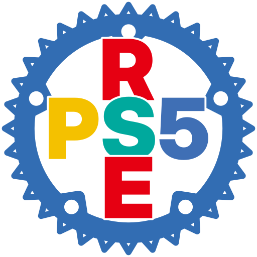</p>

<h1 align="center">RustPS5Emu (RPS5E)</h1>

<p align="center">A PlayStation 5 emulator written in Rust, for Linux and Windows.</p>

<p align="center"><a href="https://github.com/keklick1337/rps5e/actions/workflows/ci.yml"></a> <a href="LICENSE"></a> </p>

> I started this PS5 emulator in 2025 and have worked on it in my spare time since. Many people now want a working PS5 emulator, so I'm publishing everything I've built so far. Contributions are very welcome!
>
> — Vladislav Tislenko (keklick1337)

## What it is

RustPS5Emu is a compatibility layer for PS5 games, in the spirit of Wine:

- the game's x86-64 code runs **natively** on the host CPU;
- the system libraries (kernel, libc, graphics, audio, input, save data, networking, ...) are implemented in Rust (HLE);
- the GPU command stream is translated to **Vulkan**, and RDNA shaders are recompiled to SPIR-V.

**Status: alpha (0.1.0-alpha.1).** Games start, many reach gameplay and are partly playable; there are graphical glitches and crashes, and everything needs more testing and work. 2D games run well: nearly all of them start and can be played through. Expect bugs, and please report them (see [Reporting issues](#reporting-issues)).

`master` is the development branch: every change lands there first, so it has the newest fixes but can be unstable. Tagged versions on the [Releases](https://github.com/keklick1337/rps5e/releases) page come with prebuilt Linux and Windows archives.

### Tested games

| Game | Title ID | Status |
|---|---|---|
| Terminator 2D: NO FATE | PPSA25872 | 🟢 Works perfectly |
| SILENT HILL: The Short Message | PPSA10112 | 🟡 Playable, occasional shader glitches |
| ASTRO BOT | PPSA21567 | 🟡 Playable, shader glitches |
| Demon's Souls | PPSA01342 | 🟡 Playable, graphical glitches |
| Grand Theft Auto V | PPSA04263 | 🟡 Playable; low fps and shader-compile stutter for now |
| Marvel's Spider-Man 2 | PPSA08338 | 🔴 Starts, but models render broken and without textures; not playable |

The emulator runs **decrypted** game dumps (a folder with `eboot.bin` and `sce_sys/`) and fake packages (`.pkg`, `.ffpkg`). Retail-encrypted packages cannot be used. You need your own legally dumped games; none are provided.

## Screenshots

<p align="center">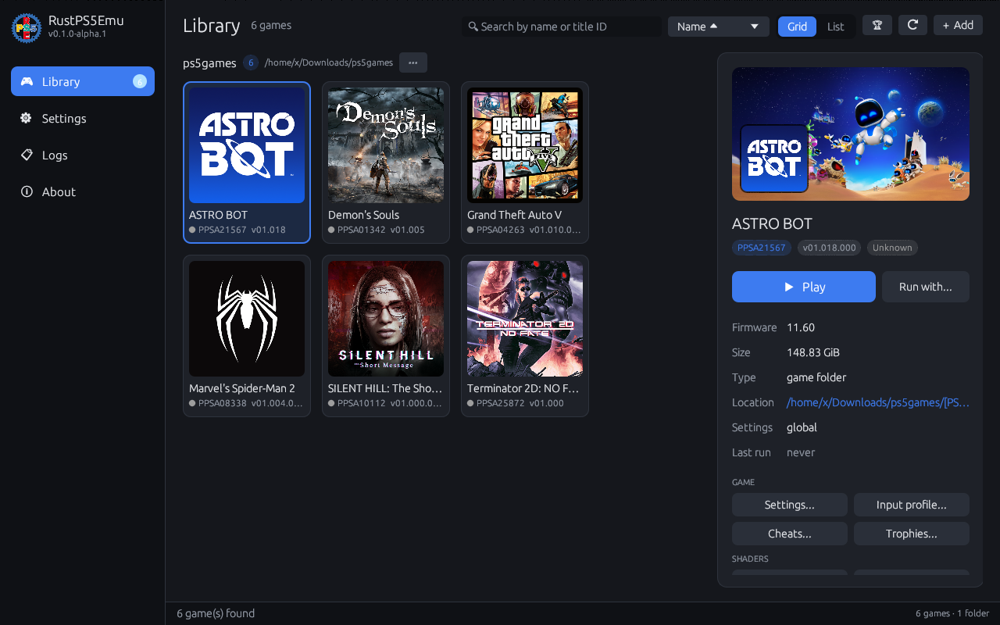</p>

| | |
|---|---|
| 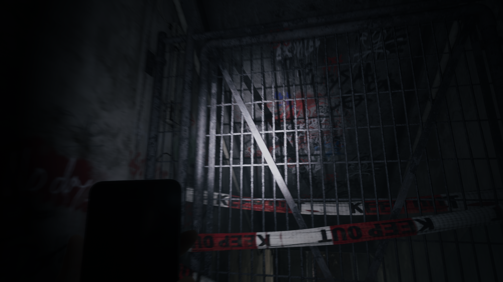<br>**SILENT HILL: The Short Message** — PPSA10112<br>🟡 occasional shader glitches | 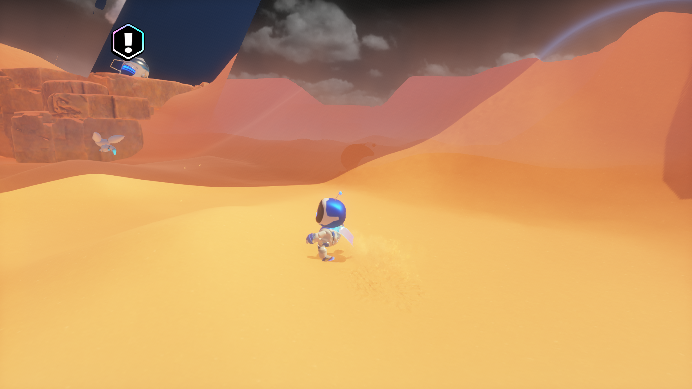<br>**ASTRO BOT** — PPSA21567<br>🟡 shader glitches |
| 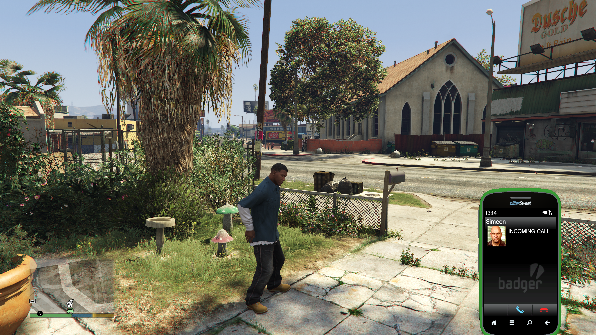<br>**Grand Theft Auto V** — PPSA04263<br>🟡 playable, low fps and shader stutter | 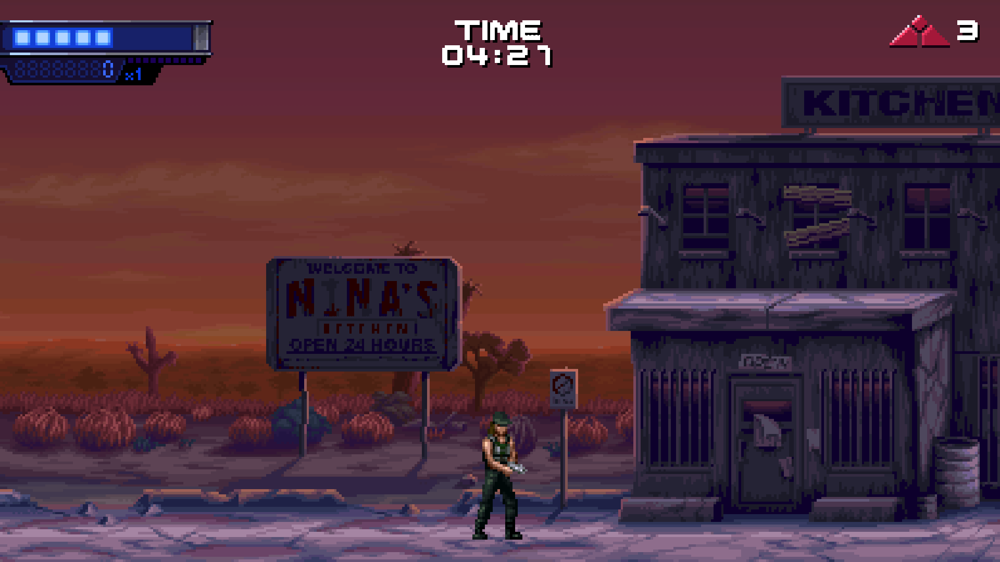<br>**Terminator 2D: NO FATE** — PPSA25872<br>🟢 works perfectly |
| 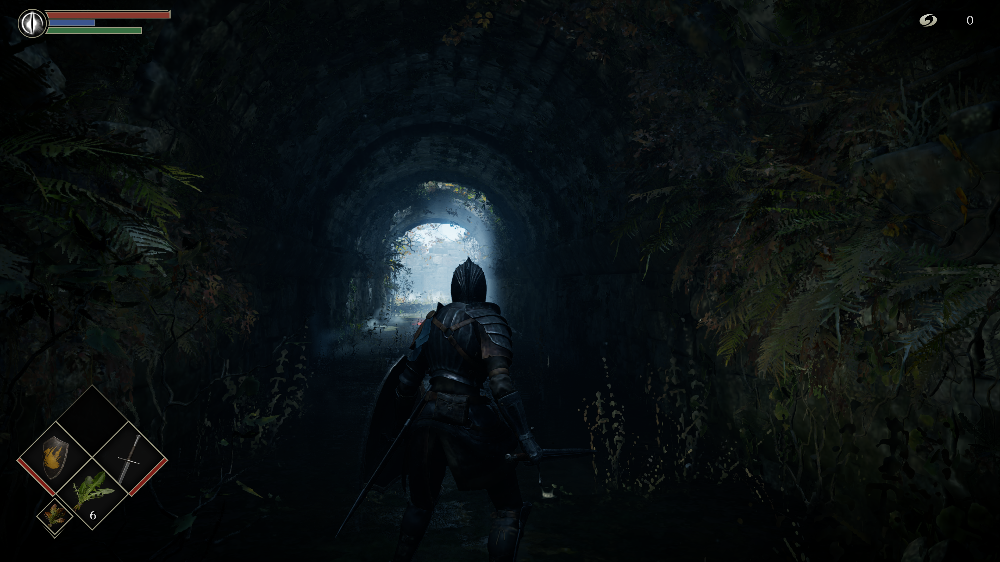<br>**Demon's Souls** — PPSA01342<br>🟡 graphical glitches | |

All frames come from the emulator's own frame dump at the game's native resolution (4K, Terminator 2D 1080p), unscaled and lossless; click a picture for the full size.

## Features

- **Launcher (GUI)**: game library (folders searched for games, single games, packages), grid and list views, covers, per-game settings, run logs, and everything else below without a terminal.
- **Controls, globally and per game**: keyboard, mouse and controllers (DualSense, DualShock 4, Xbox, anything SDL3 knows) with press-to-bind. Global defaults plus per-game overrides (input profiles), up to 4 players, DualSense adaptive triggers, light bar, touch pad and motion.
- **In-game menu** (F1 or the controller's PS button): controls, graphics, audio and system settings over the running game.
- **Shader precompilation and cache sharing**: a game compiles its known shaders before it starts, like PC games do; a game's shader cache can be exported and imported, so one player's cache saves the next player the compiling.
- **Input recording and replay**: record a play session once, replay it as an unattended, repeatable test with frame times and frame dumps.
- **Issue reports**: one click opens a prefilled issue with the game, your system and the last log lines.
- Performance overlay (F10), frame capture and replay for GPU debugging, cheats (mods JSON), trophies.

<p align="center">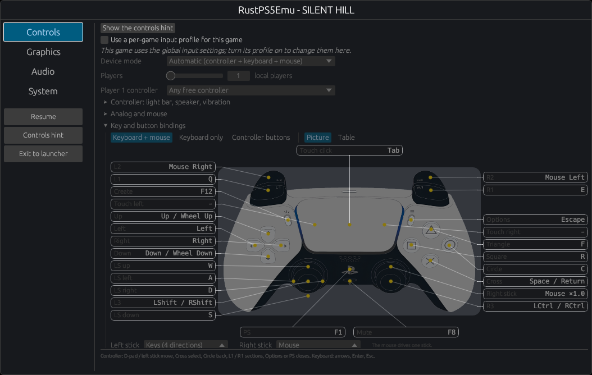</p>

## Progress

[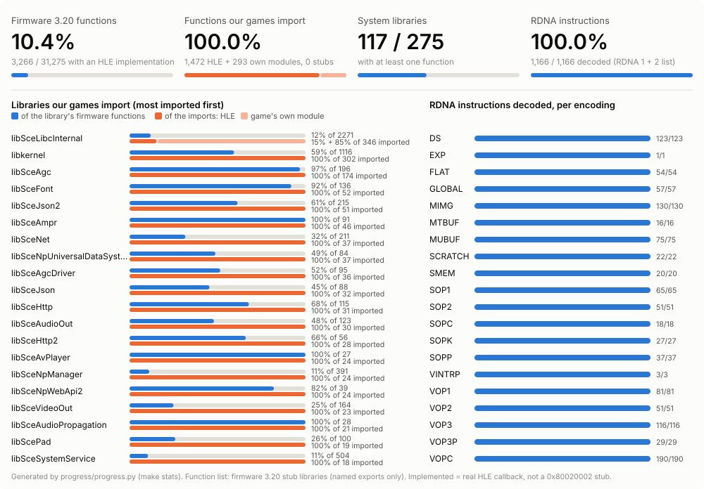](progress/PROGRESS_STATS.md)

`make stats` regenerates the picture and the tables in [`progress/PROGRESS_STATS.md`](progress/PROGRESS_STATS.md). It reads static listings only (`rps5e-cli hle-exports`, `rps5e-cli imports`, `ps5shader-dis --list-opcodes`) and never starts a game; game folders come from `GAMES_DIR` or `local/games.conf`.

## Building

Short version for Linux (Rust stable, a C compiler, `pkg-config`, Vulkan and OpenSSL development files; FFmpeg optional for movies):

```sh
make build          # = cargo build --release
make install        # rps5e + rps5e-cli, desktop entry and icons into ~/.local
```

The binaries end up in `target/release/`:

| Binary | What it is |
|---|---|
| `rps5e` | the launcher (GUI); with a command it acts as the CLI |
| `rps5e-cli` | the command line; without a command it opens the launcher too |

Windows builds (native with MSYS2, or cross-compiled from Linux) produce `rps5e.exe` and `rps5e-cli.exe` with the same roles. Requirements, the Windows steps and release packaging are in [BUILD.md](BUILD.md).

**Host requirements in short:** an x86-64-v3 CPU (Intel Haswell / AMD Zen or newer), a Vulkan 1.3 GPU with `VK_KHR_fragment_shader_barycentric` (NVIDIA Turing+, AMD RDNA2+, Intel Arc), 16 GB of RAM or more.

## Running games

### From the launcher

Start `rps5e` (or the "RustPS5Emu" desktop entry after `make install`).

The sidebar switches between Library, Settings, Logs and About; while a game runs, it shows the game with a Stop button.

- **Add games**: "+ Add" > Library folder, Game folder, Game file or Install package. Library folders are searched for game folders (`eboot.bin`) and packages; Settings > Library lists them with their game counts, and each one can be switched off without removing it. Games show their cover, title, title ID, version and size as a grid or a list, sorted by name, title ID, size, status or last played; search by name or title ID.
- **Play**: double click, or select a game and press Play in its details panel. Each game runs as a child process, so a crash never closes the launcher; its output appears on the Logs page and in `~/.local/share/rps5e/logs/`. The details panel also shows the game's background picture, size, location, settings, how its last run ended and your compatibility notes.
- **Run with...**: a run with debugging options (log filter `RUST_LOG`, GPU profile, performance overlay, shader compile wait, HLE call trace, frame dump), kept per game, with the exact command line to copy.
- **Logs**: the live log with a level filter (all, warnings, errors) and search, earlier run logs, Stop, and the command line of the run.
- **Game actions** (details panel or right click): settings, input profile, cheats, trophies, shaders (compile, recompile, export, import), open the folder, copy the command line, remove save data, report issue, remove from the library.
- **Settings**: library folders, emulator defaults (present mode, GPU, fullscreen, language, folders, ...), input and controls, theme and network. Each game can override the emulator settings and the controls (Input profile).

### From the command line

```sh
rps5e-cli run "<game folder or eboot.bin or .pkg>" [options]
rps5e-cli run ~/games/PPSA10112 --input-mode keyboard --fullscreen
scripts/run-game.sh ~/games/PPSA10112 --bind Cross=KEY:Space
```

Useful `run` options (`rps5e-cli run --help` lists all; most have an `RPS5E_*` environment variable too):

| Option | Meaning |
|---|---|
| `--data-dir DIR` | saves and per-title data (default `~/.local/share/rps5e`) |
| `--config-dir DIR` | input settings: `rps5e-input.toml`, `profiles/<TITLE_ID>.toml` (default `~/.config/rps5e`) |
| `--input-mode MODE` | `auto` (controller + keyboard + mouse), `keyboard_mouse`, `keyboard`, `controller` |
| `--bind ACTION=SRC[,SRC]` | rebind an action (`KEY:<name>`, `MOUSE:Left`, `WHEEL:Up`; see [`rps5e-input.example.toml`](rps5e-input.example.toml)) |
| `--fullscreen`, `--no-input`, `--mute` | fullscreen window; ignore host input; no audio |
| `--perf-overlay`, `--hdr` | performance overlay from the start; HDR10 output when the display offers it |
| `--pad-script 20:cross,26:down` | scripted button presses (seconds:button) for unattended runs |
| `--record-input FILE`, `--replay-input FILE` | record the pad, or replay a recording |
| `--dump-frames DIR --dump-every N` | save every Nth frame as an image |
| `--compile-wait MS\|exact` | how long a draw waits for its shaders before it is skipped (default 3 ms; `exact` always waits) |
| `--game-patch FILE` | apply a cheat/patch file (mods JSON) at load |

Packages:

```sh
rps5e-cli info-pkg game.pkg                  # title ID, version, content ID, files
rps5e-cli install-pkg game.pkg [--into DIR]  # extract into a game folder
rps5e-cli run game.pkg                       # mount read-only as /app0 and start
```

Fake PKGs, raw PFS images and PFSC-compressed images are supported; retail-encrypted packages, delta updates and DLC are not (yet).

Other commands: `info`, `imports` (which imports are HLE, the game's own module, or missing), `self2elf` (the ELF inside a decrypted module, for disassemblers), `replay` (a GPU frame capture as a benchmark).

### Data folders

| What | Linux | Windows |
|---|---|---|
| saves, per-title data, run logs | `~/.local/share/rps5e` | `%LOCALAPPDATA%\rps5e` |
| launcher and input settings | `~/.config/rps5e` | `%APPDATA%\rps5e` |
| shader and pipeline caches | `~/.cache/rps5e` | `%LOCALAPPDATA%\rps5e` |

## Controls

In the launcher: Settings > Input and controls (global) or the game's "Input profile" (per game). In a game: F1 or the PS button opens the in-game menu; its Controls page shows the DualSense with the current bindings, and every action can be rebound by pressing the new key, mouse button or controller button. Global bindings are the defaults; a per-game profile (`profiles/<TITLE_ID>.toml`) overrides them for that game.

- Device modes: `auto` (controller, keyboard and mouse together), `keyboard_mouse`, `keyboard` (right stick on I/J/K/L), `controller`.
- Controllers through SDL3: DualSense, DualShock 4, Xbox and anything in SDL's database, hot-pluggable, with rumble, light bar, adaptive triggers, touch pad and motion sensors.
- Keyboard and mouse (defaults): WASD left stick, the mouse right stick (mouse-look while captured, with sensitivity and invert Y in the settings), arrow keys D-pad, Space or Enter Cross, C Circle, R Square, F Triangle, Q / E L1 / R1, right / left mouse button L2 (aim) / R2 (fire), Shift / Ctrl L3 / R3, Escape Options, Tab touch pad click, F12 Create (saves a screenshot of the game window), F8 mute (the game's sound). "Swap sticks" puts WASD on the right stick and the mouse on the left.
- Game window keys (defaults): F1 menu (the PS button), F2 (hold) shows the current bindings over the running game, F11 fullscreen, F10 performance overlay, F9 toggles mouse capture (mouse-look), Escape releases the mouse and presses Options.
- Motion sensors from the keyboard: numpad 8 / 2 tilt the controller forward / back, 4 / 6 tilt it left / right, 7 / 9 turn it, 5 shakes it; tilts ease in, hold, and come back level on release. Holding the middle mouse button lets the mouse turn the controller (gyro aiming). Games get what a DualSense reports: orientation, gravity in the accelerometer and the turn rate in the gyroscope. Tilt angle, speed and mouse sensitivity are settings.
- Touch pad from the keyboard: numpad 0 toggles touch pad mode, where numpad 1-9 touch nine zones (7 8 9 is the top row; two keys held are two fingers) and the mouse moves a finger (left button touches, right button clicks). Home / Delete / End / Page Down swipe up / left / down / right, Page Up touches the middle, Insert holds two fingers.
- Every action can be rebound, globally or per game; the Controls page lists the motion and touch pad actions under the controller picture.

<p align="center">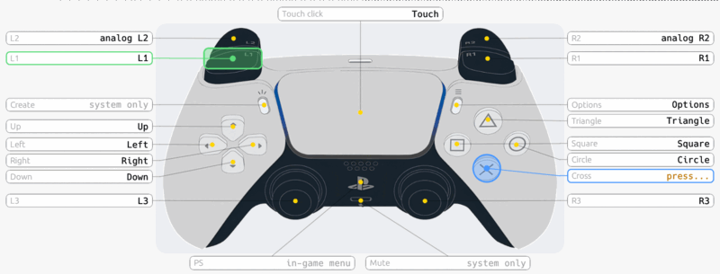</p>

<p align="center">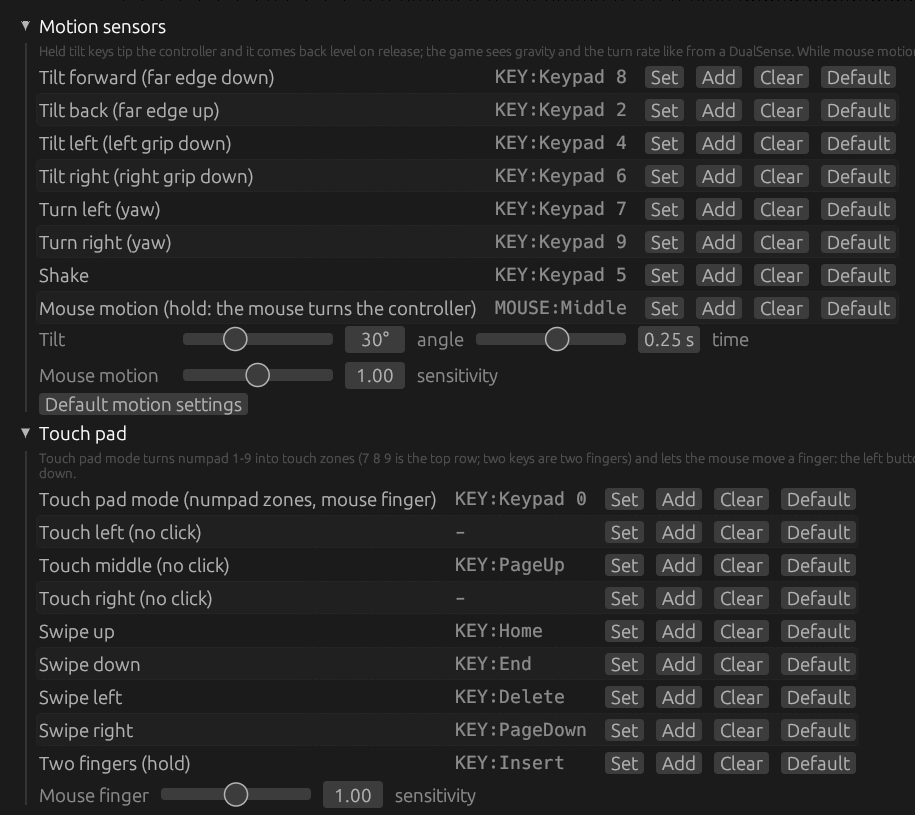</p>

<p align="center">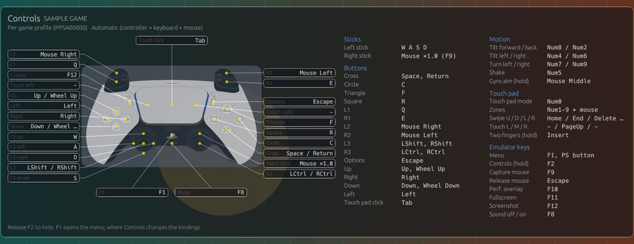</p>

Every option of the settings file is documented in [`rps5e-input.example.toml`](rps5e-input.example.toml).

## Shader cache

PS5 games ship GPU shaders as RDNA machine code; the emulator translates them to SPIR-V and builds Vulkan pipelines. To avoid stutter during play:

- **Precompile**: each game records the shaders and pipelines it creates. On the next start the emulator compiles that whole list before the game runs, with a progress panel (`--no-prewarm-wait` starts at once and compiles in the background). Launcher: game menu > Shaders > Compile shaders now / Recompile shaders. CLI: `rps5e-cli precompile <game folder or title ID> [--clear]`.
- **Export / import**: a player who has played a game can share its shader list. Launcher: Shaders > Export shader cache... / Import shader cache.... CLI: `rps5e-cli shader-cache export <game> <file>.shadercache` and `rps5e-cli shader-cache import <file>`. The file holds guest shader code and pipeline state only (no SPIR-V, driver data or local paths), so it works with any GPU; a file of another game or game version is refused. Imported entries are merged and compiled on the next start or precompile.

## Input recording and replay

Recordings make bugs and performance repeatable: record a scene once, replay it after every change.

```sh
scripts/input-test.sh record <game folder> <name>   # play; close the window to stop
scripts/input-test.sh replay <game folder> <name>   # unattended replay with statistics
scripts/input-test.sh list
```

- `<game folder>` is the folder holding the game's `eboot.bin`; recordings are named after its title ID.
- A recording is saved as `local/recordings/<TITLE_ID>-<name>.txt` together with a copy of the save data it started from (`.data`), so the replay starts from the same state.
- A replay ignores host input and writes `summary.txt` (average, minimum and 1%-low fps, frame-time percentiles, stalls), `frametimes.txt`, frame dumps and the full log to `local/tmp/input-test/<TITLE_ID>-<name>-<time>/`.

Tips for recordings that replay well: run the game once before recording so its shaders are compiled; wait 2-3 seconds before the first press and after each loading screen; move the camera with the stick rather than the mouse; do not open the emulator menu or switch windows; keep each recording to 3-10 minutes.

Without the script: `rps5e-cli run <game> --record-input FILE` and `--replay-input FILE`. Recordings store pad state changes with their time since start (buttons, sticks, triggers; not motion).

## Reporting issues

In the launcher, right click a game > **Report issue...** (or the "Report issue" button of the selected game). After a game crashes, the launcher offers the same. It opens a prefilled new issue on [github.com/keklick1337/rps5e/issues](https://github.com/keklick1337/rps5e/issues) in your browser with the game title, title ID and version, the emulator version, your OS and GPU, and the last log lines. Nothing is sent until you submit it; please describe what you did and what went wrong, and attach screenshots or the full log (`~/.local/share/rps5e/logs/`) if you can.

## Contributing

See [CONTRIBUTING.md](CONTRIBUTING.md), [CHANGELOG.md](CHANGELOG.md) and [SECURITY.md](SECURITY.md).

## License

Copyright (C) 2025-2026 Vladislav Tislenko (keklick1337).

RustPS5Emu is free software, licensed under the GNU General Public License, version 2 only (GPL-2.0-only); see [LICENSE](LICENSE).

"PlayStation" and "PS5" are trademarks of Sony Interactive Entertainment. This project is not affiliated with or endorsed by Sony.
